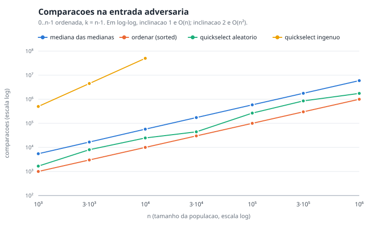
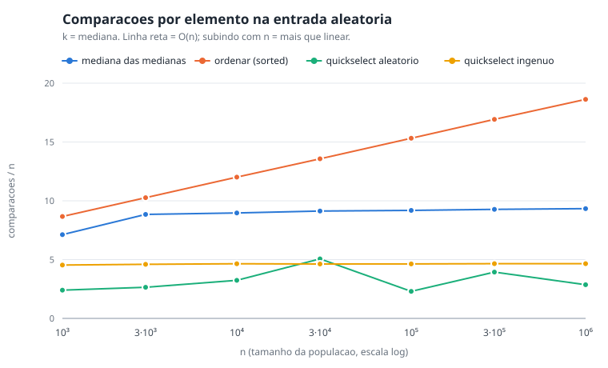

**Vídeo de apresentação:** [GP 14 - PA - Dividir e Conquistar - 2026-2](https://youtu.be/lCqhpXO-TG0)

# Pokémon CLI: o Ginásio (Trabalho 3, Dividir e Conquistar)

Relatório final: [`docs/relatorio-trabalho-3.md`](docs/relatorio-trabalho-3.md)

Projeto de Algoritmos (FGA0124) | Grupo 14 | Módulo 3: Dividir e Conquistar

| Matrícula | Aluno |
| --- | --- |
| 190091681 | Lucas Gabriel Antunes |
| 202045965 | Augusto Campos Duarte |

## Proposta

O líder de ginásio monta o time calibrado pelo k-ésimo nível da população
selvagem da região: em vez de escolher um nível na mão, ele seleciona o
k-ésimo elemento dos níveis dos Pokémon selvagens. A seleção roda em O(n)
garantido pela mediana das medianas. O benchmark compara essa seleção contra
ordenar tudo e contra o quickselect, incluindo uma entrada adversária em que o
quickselect de pivô ingênuo degrada para n². A interface 2.5D em Phaser fica
no `webdemo`.

## Trabalhos anteriores

- Trabalho 1 (Grafos): [`docs/README-trabalho-1.md`](docs/README-trabalho-1.md)
- Trabalho 2 (Algoritmos Ambiciosos): [`docs/README-trabalho-2.md`](docs/README-trabalho-2.md)

## Como rodar

```bash
python -m venv .venv && source .venv/bin/activate
pip install -r requirements.txt
python -m pytest                  # testes
python -m webdemo                 # interface web (abre o navegador)
```

A interface sobe em `http://127.0.0.1:<porta>/`. Use `--porta N` para escolher
a porta e `--sem-navegador` para não abrir o navegador.

Na interface, o link **Mundo 2.5D (T3)** no topo abre o jogo com ginásios
(`/mundo.html?size=12&seed=1`, o mapa usado no vídeo e no relatório), e a aba
**Benchmark > Trabalho 3 · Seleção** mostra os resultados da seleção, com
seletores de entrada e de medida.

Terminal (jogo dos Trabalhos 1 e 2):

```bash
python main.py --bot --size 8 --seed 4 --energia 64 --estrategia guloso
```

Benchmark:

```bash
python -m bench --so selecao      # seleção do k-ésimo (T3), ~2 min
python -m bench --so graficos     # regenera os SVGs a partir dos CSVs
python -m bench                   # tudo: rotas, partidas, paradas (T1/T2) e seleção
```

## Benchmark da seleção

`bench/selecao.py` compara quatro jeitos de achar o k-ésimo menor, com n de
10³ a 10⁶ (7 tamanhos × 3 seeds):

- **mediana das medianas** (`dc.mediana_medianas.selecionar`): O(n) no pior caso;
- **ordenar**: `sorted(valores)[k]`, o sort do Python (Timsort, em C);
- **quickselect aleatório**: O(n) esperado;
- **quickselect ingênuo**: pivô = primeiro elemento, O(n²) no pior caso.

São três entradas: **aleatória** (inteiros em [0, 10⁹), k = mediana), **níveis**
(níveis de 1 a 100, k = mediana, que é a população real do jogo) e
**adversária** (0..n−1 já ordenada, k = n−1, o pior caso do pivô ingênuo).
Cada medição registra o menor tempo de 3 execuções e o número de comparações
entre elementos, que não depende da máquina. Toda resposta é conferida contra
`sorted()`: nas 240 medições, todas bateram. O quickselect ingênuo na
adversária só roda enquanto a estimativa quadrática fica abaixo de 10 s por
execução. Os tamanhos cortados vão para `selecao_descartes.csv` com a
estimativa (10⁶ levaria cerca de 6,8 horas).

**Entrada adversária, n = 10⁴:**

| algoritmo | comparações | tempo |
| --- | ---: | ---: |
| quickselect ingênuo | 50.004.999 | 2.409 ms |
| mediana das medianas | 57.258 | 3,9 ms |
| quickselect aleatório | 24.657 | 1,3 ms |
| ordenar | 9.999 | 0,05 ms |



**Comparações por elemento** (comparações / n): uma linha reta significa O(n).

| entrada | mediana das medianas, n = 10³ → 10⁶ | ordenar, n = 10³ → 10⁶ |
| --- | --- | --- |
| aleatória | 7,1 → 9,3 (estabiliza em ~9) | 8,7 → 18,6 (cresce com log n) |
| níveis | 7,4 → 3,5 | 8,6 → 10,6 |
| adversária | 5,4 → 5,9 | 1,0 → 1,0 |



O que os números mostram:

1. **Só a mediana das medianas é linear nas três entradas.** As comparações por
   elemento ficam paradas em todas elas. O quickselect ingênuo vai de 500 para
   5.000 comparações por elemento entre 10³ e 10⁴, crescendo junto com n,
   que é o O(n²).
2. **Na média ela não é a mais rápida.** Na entrada aleatória com n = 10⁶ leva
   584 ms, contra 209 ms do `sorted()` e 241 ms do quickselect aleatório. O sort
   faz o dobro de comparações (18,6n contra 9,3n), mas roda em C. A vantagem
   dela é a garantia, não a velocidade.
3. **O Timsort é adaptativo.** Em entrada já ordenada ele reconhece a sequência
   e faz n − 1 comparações. Por isso a entrada adversária é adversária só para o
   pivô ingênuo; o sort é O(n log n) no pior caso, não em toda entrada.
4. **Na população do jogo os três seletores empatam.** Com só 100 valores
   distintos, a partição em três (menores / iguais / maiores) termina em poucas
   rodadas. A mediana das medianas cai para 3,5 comparações por elemento e
   empata com os dois quickselects (cerca de 170 ms com n = 10⁶). O `sorted()`
   ainda é cerca de 2× mais rápido.
5. **O quickselect aleatório oscila** (de 2,3n a 5,1n comparações, conforme o
   sorteio). Linear no esperado, sem garantia.

Gráficos de tempo: [aleatória](bench/out/selecao-tempo-aleatoria.svg),
[níveis](bench/out/selecao-tempo-niveis.svg),
[adversária](bench/out/selecao-tempo-adversaria.svg). Dados brutos em
`bench/out/selecao.csv`, médias em `bench/out/selecao_resumo.csv`.
