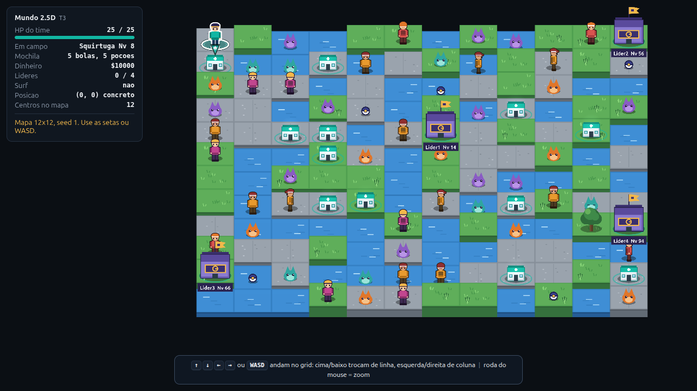
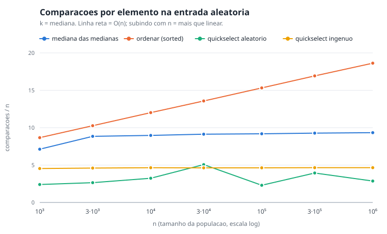
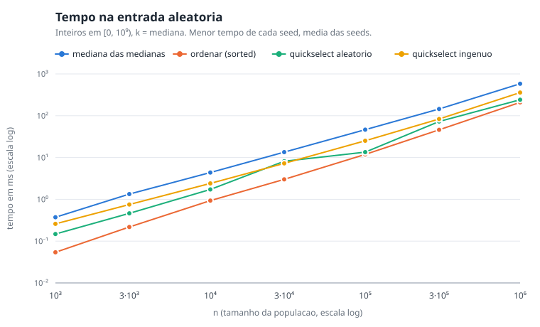
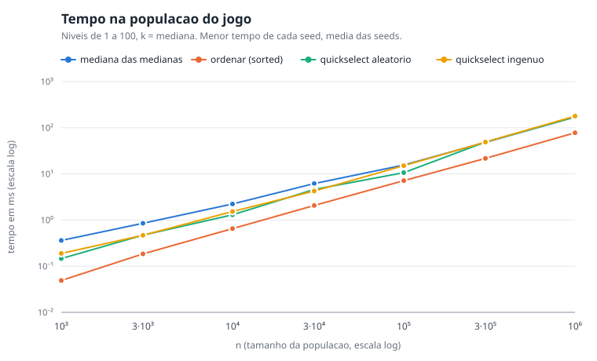
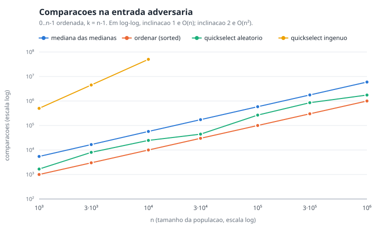
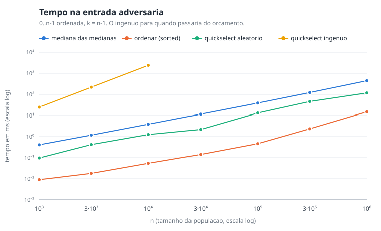

# Relatório final: Pokémon CLI, o Ginásio

**Disciplina:** Projeto de Algoritmos, FGA0124, UnB/FCTE
**Grupo 14** | Módulo 3: Dividir e Conquistar

| Matrícula | Aluno | Entregas segundo o histórico do repositório |
| --- | --- | --- |
| 190091681 | Lucas Gabriel Antunes | Mediana das medianas, testes e prova; ginásios, regiões e líderes; motor de batalha, API e níveis; mundo 2.5D e tela de batalha. 31 commits, 24 sem contar merges, todos de 27/10 |
| 202045965 | Augusto Campos Duarte | Benchmark da seleção: commit de 29/10, integrado pelo pull request nº 1 em 02/11 |

**Vídeo de apresentação:** [GP 14 - PA - Dividir e Conquistar - 2026-2](https://youtu.be/lCqhpXO-TG0)

## 1. Introdução

Os Trabalhos 1 e 2 deram ao jogo de Pokémon de terminal duas otimizações. A
primeira é uma rota barata, o Dijkstra sobre um grafo cujos pesos dependem do
estado do jogador. A segunda é uma política de paradas ótima, o guloso do
caminhoneiro. O Trabalho 3 põe ginásios no mapa e, com eles, um problema de
outra natureza: calibrar o time do líder pela população de Pokémon selvagens da
região. O líder não recebe um nível escolhido à mão. Ele toma o k-ésimo menor
nível da população, a mediana no primeiro ginásio e percentis mais altos nos
seguintes.

Achar o k-ésimo menor é o problema da seleção. Há três jeitos de resolvê-lo.
Ordenar a lista inteira custa O(n log n). O quickselect escolhe um pivô, divide
a lista em menores, iguais e maiores que ele e continua só no lado onde o
k-ésimo cai, o que custa O(n) em média e O(n²) quando o pivô é ruim. A mediana
das medianas escolhe o pivô de um modo que o impede de ser ruim e com isso
garante O(n) no pior caso. Nas três variantes de seleção o método é dividir e
conquistar com conquista por descarte: cada rodada abandona pelo menos um dos
lados da partição. Ordenar também é dividir e conquistar, mas sem descarte.

A tese do trabalho cabe em duas frases. A mediana das medianas é a única das
três abordagens com tempo linear garantido e não é a mais rápida: em todas as 21
combinações de entrada e tamanho medidas, o sort nativo do Python ganha no
relógio. O que a mediana das medianas compra é a garantia. O relatório prova essa garantia na seção
4 e a confronta, na seção 6, com uma entrada construída para quebrar o pivô
ingênuo.

O relatório segue a ordem das entregas. A seção 2 mostra onde a seleção entra no
jogo. A seção 3 descreve o algoritmo e a seção 4 prova o limite linear. A seção
5 trata do motor de batalha, da API e da interface 2.5D, que consomem a seleção.
A seção 6 apresenta o benchmark do Augusto e a seção 7 avalia o que ele mostra.
A seção 8 reúne as limitações sem suavizar nenhuma; a seção 9 fecha com a
conclusão e as extensões em aberto.

## 2. Onde a seleção entra no jogo

### 2.1 Regiões, populações e líderes

O mapa é dividido em blocos de 8 por 8 células; cada bloco é uma região. Cada
região guarda, por padrão, uma população de 1000 Pokémon selvagens e recebe no
máximo um ginásio, sorteado entre as células livres que não são água nem a
origem. A população é uma lista de inteiros, só o nível de cada Pokémon, porque
um milhão de objetos Pokémon pesaria demais na memória; é uma decisão registrada
no código, sem medição.

O nível da população cresce com a distância entre o bloco e a origem. A região
da origem tem níveis entre 5 e 30, a mais distante entre 50 e 100; as do meio
ficam numa interpolação linear dos dois extremos. A distribuição também é
assimétrica, com expoente 1,6 sobre um sorteio uniforme, de modo que há mais
Pokémon fracos que fortes em cada região.

O líder de cada ginásio monta um time de 3 Pokémon com o nível igual ao k-ésimo
menor da população da sua região. O percentil sobe linearmente do primeiro ao
último líder, de 0,5 a 0,9; a ordem dos líderes é a da distância da região até a
origem. O índice k sai de min(n-1, floor(p*(n-1))), o que dá k = 499 para a
mediana de uma população de 1000.

A tabela mostra o resultado em mapas 12x12, o tamanho padrão da interface.

| Mapa | Líder 1 | Líder 2 | Líder 3 | Líder 4 |
| --- | --- | --- | --- | --- |
| Percentil | 0,50 | 0,63 | 0,77 | 0,90 |
| Nível, seed 1 | 14 | 56 | 66 | 94 |
| Nível, seed 42 | 14 | 58 | 65 | 91 |

Fonte: geração do mapa com ginásios ligados, `Grid(size=12, seed=S,
ginasios=True)`. O seed 1 confere com os níveis do print da seção 5; o seed 42 é
o padrão da interface.

### 2.2 Três usos da seleção

O jogo chama a seleção em três lugares. Nenhum deles ordena.

O primeiro é o nível dos adversários. O líder usa o percentil do ginásio. O
Pokémon selvagem usa um percentil sorteado a cada encontro, numa faixa que sobe
com a distância da célula até a origem: de 0,00 a 0,12 colado na origem e de
0,15 a 0,45 no canto oposto. O treinador usa um percentil fixo, derivado da seed
do mapa e da posição dele, numa faixa de 0,00 a 0,10 na origem e de 0,30 a 0,60
no canto oposto. Por isso o mesmo treinador tem sempre o mesmo nível, em
qualquer ordem de visita.

O segundo é a decisão da CPU na batalha. O líder escolhe o golpe de maior dano esperado, que a CPU acha pedindo à seleção o último elemento da ordem. Quando o Pokémon em campo desmaia, a CPU pontua os candidatos vivos pela vantagem contra o Pokémon do jogador e escolhe, por seleção, o de pontuação mediana, no caso do treinador, ou o de pontuação mais alta, no caso do líder.

O terceiro é a previsão de balanceamento. Antes de lutar, o jogo simula 1000
batalhas em cópias do estado e resume o resultado nos percentis 10, 50 e 90, que
a tela rotula como p10, p50 e p90, cada um obtido por seleção sobre as 1000
simulações. O jogador da simulação usa uma política simples, sempre o golpe de
maior dano esperado e sem poção, pokébola nem troca voluntária, então a previsão
funciona como um piso do que um jogador atento consegue.

### 2.3 A seleção como função pura

O código da seleção vive numa camada própria, que não conhece o jogo: recebe uma
lista de números e um k e devolve um número. É a mesma separação que os
Trabalhos 1 e 2 fizeram entre os algoritmos e o mapa, com o mesmo ganho: os
testes montam listas à mão; o benchmark roda os algoritmos sobre listas de um
milhão de inteiros sem criar um único Pokémon.

O líder recebe a função de seleção como parâmetro; o padrão é a mediana das
medianas. Um teste trava esse padrão. A ordenação completa continua no código só
como gabarito dos testes. Nenhum caminho do jogo a usa.

## 3. O algoritmo

### 3.1 Seleção, quickselect e a escolha do pivô

Seja uma lista de n valores e um índice k a partir de 0. O k-ésimo menor é o
valor que ocuparia a posição k se a lista estivesse ordenada. Os três métodos
comparados no trabalho compartilham o mesmo laço: escolher um pivô, classificar
cada elemento contra ele em menor, igual ou maior e então decidir. Se k cai
entre os menores, o laço segue só com eles. Se cai entre os iguais, a resposta é
o próprio pivô. Se cai entre os maiores, o laço segue só com eles, com k
reduzido pela quantidade de menores e iguais descartados.

O que muda de um método para outro é só a escolha do pivô. O quickselect ingênuo
usa o primeiro elemento da lista. O quickselect aleatório usa um elemento
sorteado. A mediana das medianas usa um pivô que ela mesma calcula e que a prova
da seção 4 garante que não é extremo.

### 3.2 A mediana das medianas

Para escolher o pivô, a lista é dividida em grupos de 5 elementos, com o último
grupo possivelmente menor. Cada grupo é ordenado, o que custa tempo constante
por grupo; a mediana de cada um é guardada. O pivô é a mediana dessas medianas,
achada pela própria seleção, aplicada recursivamente à lista de cerca de n/5
medianas. Com o pivô na mão, o laço particiona a lista em três e continua do
lado onde o k-ésimo cai.

Na versão do código a recursão tem duas camadas. O laço principal, que descarta
um lado a cada rodada, é iterativo. A recursão que sobra é a do cálculo do pivô,
que reduz o tamanho da lista por 5 a cada nível.

### 3.3 Decisões de implementação

Quatro decisões do código merecem registro.

A partição em três. Os níveis do jogo vão de 1 a 100. Uma população de 1000
Pokémon tem quase tudo repetido. Uma partição em duas partes jogaria os iguais
ao pivô para um lado e degradaria a recursão. Na partição em três, os iguais ao
pivô só são contados, não guardados: se o k-ésimo cai entre eles, a resposta é o
pivô.

O laço iterativo. A recursão do Python tem limite de profundidade. O descarte de
um lado por rodada, escrito como recursão, o estouraria em entradas de um milhão
de elementos. Um teste roda a seleção sobre um milhão de níveis e confere a
resposta contra a ordenação.

A entrada intocada. Os três métodos copiam a lista antes de trabalhar; um teste
confere que a lista do chamador sai igual ao que entrou.

O contador de comparações. Um parâmetro opcional acumula as comparações feitas
entre elementos, para que o benchmark meça o crescimento sem depender só do
relógio. A unidade é uma classificação de três vias: classificar um elemento
contra o pivô, em menor, igual ou maior, conta 1; ordenar um grupo de 5 conta as
comparações reais do sort. No benchmark, o sort nativo é envolvido por uma
função de comparação que conta as chamadas que ele faz.

Os identificadores no código, para quem for conferir:

| Papel | Identificador | Arquivo |
| --- | --- | --- |
| Entrada pública da mediana das medianas | `selecionar` | `dc/mediana_medianas.py` |
| Cálculo do pivô | `escolher_pivo_mm` | `dc/mediana_medianas.py` |
| Laço comum aos três métodos | `_laco_selecao` | `dc/mediana_medianas.py` |
| Partição em três | `_particionar` | `dc/mediana_medianas.py` |
| Quickselect ingênuo e aleatório | `quickselect_ingenuo`, `quickselect_aleatorio` | `dc/mediana_medianas.py` |
| Entrada adversária | `gerar_adversario_ingenuo` | `dc/mediana_medianas.py` |

## 4. A prova de O(n)

A prova completa tem documento próprio no repositório. Esta seção a refaz com o
que o resto do relatório usa. Seja g = ⌈n/5⌉ o número de grupos e p o pivô, a
mediana das g medianas.

### 4.1 O pivô deixa pelo menos 3n/10 - 6 elementos de cada lado

Pelo menos metade das medianas, ou seja, ao menos ⌈g/2⌉ delas, é menor ou igual
a p. Cada grupo cuja mediana é menor ou igual a p tem 3 elementos menores ou
iguais a p: a mediana e os dois elementos abaixo dela no grupo. Duas exceções
ficam de fora da conta: o grupo do próprio p e o último grupo, que pode ser
incompleto. Descontadas, sobram

    #{x <= p} >= 3 * (⌈g/2⌉ - 2) >= 3 * (n/10 - 2) = 3n/10 - 6.

O argumento é simétrico para os elementos maiores ou iguais a p. Com valores
repetidos a conta vale do mesmo jeito, porque ela conta menores ou iguais e
maiores ou iguais; a partição em três descarta os iguais ao pivô juntos. O lado
que sobra tem no máximo n - (3n/10 - 6) = 7n/10 + 6 elementos.

### 4.2 A recorrência fecha

O custo satisfaz

    T(n) <= T(n/5) + T(7n/10 + 6) + c*n.

O primeiro termo é achar o pivô; o segundo é a recursão no lado escolhido, no
pior caso o maior; o terceiro é ordenar os grupos e particionar. Para n pequeno,
T(n) é constante. Suponha T(m) <= a*m para todo m < n. Então

    T(n) <= a*n/5 + a*(7n/10 + 6) + c*n
          =  a*n - (a*n/10 - 6a - c*n).

O parêntese é não negativo quando a*(n/10 - 6) >= c*n. Para n >= 120 vale n/10 -
6 >= n/20; com a = 20c a desigualdade fecha; os n < 120 cabem na constante da
base. Logo T(n) <= a*n e T(n) = O(n). A condição que sustenta tudo é a soma das
frações dos subproblemas ficar abaixo de 1, no caso 1/5 + 7/10 = 9/10. Cada
nível da recursão paga 9/10 do anterior; o trabalho total é uma série geométrica
que soma 10*c*n.

### 4.3 Por que grupos de 3 não bastam

Com grupos de 3, cada grupo cuja mediana é menor ou igual a p tem só 2 elementos
menores ou iguais a p. O pivô deixa pelo menos n/3 de cada lado, o lado que
sobra tem até 2n/3 e a recorrência vira T(n) <= T(n/3) + T(2n/3) + c*n. A soma
das frações é 1/3 + 2/3 = 1, não menor que 1. Cada nível da recursão paga n
inteiro e são log n níveis: a prova deixa de fechar e a recorrência resolve a
Θ(n log n), sem ganho sobre ordenar. Grupos
de 5 são o menor tamanho ímpar para o qual a soma fecha abaixo de 1.

### 4.4 Como a prova foi testada

Um teste confere a garantia do pivô nos números: para n em 50, 51, 99, 100, 500,
1001 e 5000, com valores distintos e com valores repetidos, o pivô deixa pelo
menos 3n/10 - 6 elementos de cada lado, contando os iguais a ele. Outro confere
que, na entrada adversária de mil elementos, o pivô cai entre 290 e 710, longe
das pontas.

A correção do resultado é conferida contra a ordenação completa, que serve de
gabarito. O arquivo de testes da seleção tem 63 casos, que cobrem listas
aleatórias de 1 a 1001 elementos, populações com muitos valores repetidos,
listas só com 2 valores distintos, listas de elementos todos iguais, listas
ordenadas e em ordem reversa, todos os valores de k em listas de 1 a 15
elementos, k inválido, entrada intocada e a lista de um milhão de elementos.

Dois testes medem o crescimento na entrada adversária. O quickselect ingênuo faz
exatamente n(n+1)/2 - 1 comparações. Dobrar n multiplica o custo por mais de
3,5. A mediana das medianas, ao dobrar n, multiplica por menos de 2,5 e em n =
16.000 faz menos de 40 comparações por elemento. A tabela mostra a contagem
medida.

| n | Quickselect ingênuo | Mediana das medianas |
| --- | ---: | ---: |
| 1.000 | 500.499 | 5.447 |
| 2.000 | 2.000.999 | 11.159 |

Fontes: `docs/prova-mediana-medianas.md` e `tests/test_mediana_medianas.py`. A
linha de 1.000 coincide com a do benchmark em `bench/out/selecao.csv`.

## 5. Batalha, API e interface 2.5D

### 5.1 O motor de batalha e a API

O motor de batalha roda por turnos e não conhece HTTP. Os atributos de cada
Pokémon saem do nível. O dano segue a fórmula clássica, com bônus de 1,5 para
golpe do mesmo tipo do atacante, acerto crítico com chance de 1/16 e variação
uniforme entre 0,85 e 1,0. A tabela de tipos cobre cinco tipos: fogo, água,
pedra, psíquico e normal. Todo sorteio vem de um gerador semeado pela seed do
mapa e pelo número da batalha, então a mesma seed com as mesmas ações produz os
mesmos eventos.

A casca HTTP expõe o jogo e a batalha em rotas separadas. Andar até um selvagem,
um treinador ou um ginásio devolve um encontro e não luta sozinho. A batalha
abre por uma chamada própria; cada ação do jogador devolve a lista ordenada de
eventos do turno. Quando o time inteiro desmaia, o jogador volta ao último
Centro Pokémon pisado, ou à origem. O time é curado e o dinheiro cai pela metade; a derrota não encerra a partida. Só a vitória a encerra: ela vem quando
todos os líderes do mapa caem. O contrato evolui de forma aditiva: a etapa de
progressão acrescentou campos, como o tipo do golpe nos eventos e os limites da
barra de experiência, sem alterar os que já existiam. As rotas do Trabalho 2 não
mudaram.

### 5.2 A interface

A interface é um jogo 2.5D em Phaser, uma biblioteca JavaScript de jogos 2D, na
versão 3.90.0, que o repositório traz embutida com a licença MIT. O mapa aparece
em visão oblíqua, com os ginásios marcados por uma bandeira e pelo nome e nível
do líder. A cena de batalha tem transição em mosaico, animações por tipo de
golpe, captura com pokébola, barra de experiência e o termômetro de previsão,
que mostra o resultado da previsão de balanceamento da seção 2.2 antes de o
jogador escolher a ação. São sete criaturas originais, com uma galeria para
conferir a arte.



O print mostra o mapa 12x12 de seed 1, com os quatro líderes nos níveis 14, 56,
66 e 94, os mesmos da tabela da seção 2.1.


Neste segundo print, um Squirtuga de nível 8 enfrenta um Geobruto de nível 5. O
termômetro indica 100% de vitória, com p10 de 76% do HP final do time, p50 e p90
de 100%, a partir de 1000 batalhas simuladas.

O custo da previsão foi medido no servidor com 1000 simulações: de 30 a 40 ms
para um Pokémon contra um e de 90 a 250 ms para um time de 3 contra o time de 3
de um líder. A fonte é a documentação da API, que registra a medição como feita numa máquina não identificada. O custo cabe numa requisição. O número de simulações é parâmetro.

## 6. Benchmark da seleção, por Augusto Campos Duarte

### 6.1 Decisões de desenho

Cinco decisões sustentam a comparação: os quatro seletores, as três entradas, as
duas medidas, a conferência das respostas e o orçamento de tempo.

Os quatro seletores. A mediana das medianas é o que o jogo usa. O sort nativo do
Python, o Timsort, é implementado em C, reconhece sequências já ordenadas e
serve ao mesmo tempo de gabarito e de piso prático. O quickselect aleatório tem
O(n) esperado em qualquer entrada. O quickselect ingênuo, com pivô no primeiro
elemento, existe para mostrar o pior caso.

As três entradas. A aleatória usa inteiros sorteados em [0, 10⁹) e k na mediana,
o caso médio. A de níveis usa inteiros de 1 a 100 e k na mediana, o caso de
muitos valores repetidos. A adversária usa 0, 1, ..., n - 1 já ordenada com k =
n - 1: o pivô ingênuo é sempre o mínimo e descarta um elemento por rodada, o que
dá n(n+1)/2 - 1 comparações.

As duas medidas. O tempo é o menor de 3 execuções, com o coletor de lixo
desligado, como faz o módulo de cronometragem da biblioteca padrão do Python. As
comparações vêm de uma execução separada, porque o contador pesa no relógio.
Elas não dependem da máquina.

A conferência das respostas. Toda resposta é comparada com `sorted(valores)[k]`;
nas 240 medições todas bateram.

O orçamento de tempo. O quickselect ingênuo na entrada adversária é quadrático.
Em n = 10⁶ levaria horas. Antes de cada medição, o tempo é estimado a partir do
tamanho anterior supondo crescimento quadrático. Se a estimativa passa de 10 s
por execução, a medição não roda e vai para um arquivo de descartes com a
estimativa, em vez de sumir.

A grade tem 7 tamanhos, de 10³ a 10⁶, com 3 sementes por tamanho: 10³, 3 x 10³,
10⁴, 3 x 10⁴, 10⁵, 3 x 10⁵ e 10⁶. São 252 combinações de entrada, tamanho, algoritmo
e semente; 12 foram descartadas pelo orçamento; as 240 restantes formam as
linhas de `bench/out/selecao.csv`. O resumo, com a média das 3 sementes, tem 80
linhas em `bench/out/selecao_resumo.csv`.

### 6.2 Como reproduzir

```bash
python -m bench --so selecao      # mede e grava os CSVs, cerca de 2 min
python -m bench --so graficos     # regenera os SVGs a partir dos CSVs
python -m pytest -q tests/test_bench_selecao.py
```

Os 8 testes do benchmark usam uma grade minúscula de propósito, com tamanhos 200
e 600. Garantem o contrato: uma linha por algoritmo, resposta conferida contra o
gabarito, descarte registrado e gráficos gerados. A máquina e a versão do Python
em que a grade completa foi medida não estão registradas nos arquivos: a
confirmar.

### 6.3 Resultado: comparações por elemento

A tabela traz as comparações divididas por n, a média de 3 sementes, para quatro
dos sete tamanhos. A razão não depende da máquina. Uma linha reta indica custo
linear.

| Entrada | Algoritmo | n = 10³ | n = 10⁴ | n = 10⁵ | n = 10⁶ |
| --- | --- | ---: | ---: | ---: | ---: |
| Aleatória | Mediana das medianas | 7,1 | 9,0 | 9,2 | 9,3 |
| Aleatória | Ordenar | 8,7 | 12,0 | 15,3 | 18,6 |
| Aleatória | Quickselect aleatório | 2,4 | 3,2 | 2,3 | 2,9 |
| Aleatória | Quickselect ingênuo | 4,5 | 4,6 | 4,6 | 4,7 |
| Níveis | Mediana das medianas | 7,4 | 4,9 | 3,5 | 3,5 |
| Níveis | Ordenar | 8,6 | 10,3 | 10,6 | 10,6 |
| Níveis | Quickselect aleatório | 2,5 | 2,6 | 2,1 | 2,9 |
| Níveis | Quickselect ingênuo | 3,6 | 3,1 | 3,1 | 3,1 |
| Adversária | Mediana das medianas | 5,4 | 5,7 | 5,9 | 5,9 |
| Adversária | Ordenar | 1,0 | 1,0 | 1,0 | 1,0 |
| Adversária | Quickselect aleatório | 1,7 | 2,5 | 2,7 | 1,8 |
| Adversária | Quickselect ingênuo | 500,5 | 5.000,5 | - | - |

Fonte: `bench/out/selecao_resumo.csv`, coluna `comparacoes_por_n`. Os traços
marcam os tamanhos que o orçamento descartou, tema da seção 6.6.

A mediana das medianas ficou entre 3,5 e 9,3 comparações por elemento nas 63
medições dela: na aleatória sobe de 7,1 para 9,3 e estabiliza perto de 9, na
adversária e na de níveis fica praticamente estável. O sort sobe de
8,7 para 18,6 na entrada aleatória e de 8,6 para 10,6 na de níveis, enquanto n
cresce mil vezes. Na adversária fica em 1,0. O quickselect aleatório oscila
entre 1,5 e 5,1 comparações por elemento no resumo. O ingênuo fica perto de 4,6
na aleatória e de 3,1 em níveis, mas na adversária sobe de 500,5 para 5.000,5
entre 10³ e 10⁴, na mesma proporção em que n cresce. A seção 7 interpreta esse
padrão.

A figura mostra a mediana das medianas, o sort e o quickselect aleatório na
entrada aleatória.



### 6.4 Resultado: tempo

A tabela traz o tempo em milissegundos, a média sobre 3 sementes do menor tempo de 3 execuções, no menor e no maior tamanho da grade.

| Entrada | Algoritmo | n = 10³ | n = 10⁶ |
| --- | --- | ---: | ---: |
| Aleatória | Mediana das medianas | 0,373 | 583,6 |
| Aleatória | Ordenar | 0,054 | 208,8 |
| Aleatória | Quickselect aleatório | 0,148 | 241,0 |
| Aleatória | Quickselect ingênuo | 0,259 | 357,9 |
| Níveis | Mediana das medianas | 0,361 | 171,5 |
| Níveis | Ordenar | 0,049 | 77,7 |
| Níveis | Quickselect aleatório | 0,146 | 171,8 |
| Níveis | Quickselect ingênuo | 0,189 | 178,5 |
| Adversária | Mediana das medianas | 0,410 | 443,3 |
| Adversária | Ordenar | 0,009 | 15,0 |
| Adversária | Quickselect aleatório | 0,097 | 117,4 |
| Adversária | Quickselect ingênuo | 24,7 | - |

Fonte: `bench/out/selecao_resumo.csv`, coluna `tempo_ms_medio`, arredondada.

O sort foi o mais rápido nas 21 combinações de entrada e tamanho. Em n = 10⁶ a
mediana das medianas levou 583,6 ms na entrada aleatória, contra 208,8 do sort e
241,0 do quickselect aleatório. Em níveis, com n = 10⁶, os três seletores
ficaram em 171,5, 171,8 e 178,5 ms; o sort, em 77,7 ms.





### 6.5 Resultado: a entrada adversária

A tabela mostra comparações e tempo, em milissegundos, nos três tamanhos em que
o quickselect ingênuo rodou.

| Algoritmo | n = 10³ | n = 3 x 10³ | n = 10⁴ |
| --- | ---: | ---: | ---: |
| Quickselect ingênuo | 500.499 / 24,7 | 4.501.499 / 219,1 | 50.004.999 / 2.408,5 |
| Mediana das medianas | 5.447 / 0,410 | 16.682 / 1,18 | 57.258 / 3,87 |
| Quickselect aleatório | 1.672 / 0,097 | 8.014 / 0,419 | 24.657 / 1,25 |
| Ordenar | 999 / 0,009 | 2.999 / 0,018 | 9.999 / 0,054 |

Fonte: `bench/out/selecao_resumo.csv`. Cada célula traz comparações e tempo em
ms.

Com n = 10⁴, o ingênuo fez 50.004.999 comparações em 2.408,5 ms e a mediana das
medianas fez 57.258 em 3,87 ms. Ao multiplicar n por 10, de 10³ para 10⁴, as
comparações do ingênuo foram multiplicadas por 99,9; as da mediana das medianas,
por 10,5. Os quocientes são 50.004.999 / 500.499 e 57.258 / 5.447.





### 6.6 Resultado: o que o orçamento descartou

Quatro medições não rodaram, todas do quickselect ingênuo na entrada adversária;
cada uma ficou registrada com a estimativa quadrática.

| n | Tempo estimado por execução |
| --- | ---: |
| 3 x 10⁴ | 21,9 s |
| 10⁵ | 243,2 s |
| 3 x 10⁵ | 2.188,7 s |
| 10⁶ | 24.318,4 s, cerca de 6,8 horas |

Fonte: `bench/out/selecao_descartes.csv`. São estimativas por extrapolação
quadrática a partir do tamanho anterior, não medições.

## 7. Discussão: o que os resultados sustentam

A garantia custa tempo de relógio. A medição mostra o preço. Em n = 10⁶ a
mediana das medianas levou 2,8 vezes o tempo do sort na entrada aleatória, 2,2
vezes em níveis e cerca de 30 vezes na adversária. Em n = 10³, o tamanho da
população de cada região do jogo, o sort foi cerca de 7 vezes mais rápido nas
entradas aleatória e de níveis. A razão provável é que o sort roda em C e os
seletores rodam em Python, com mais alocação de listas por rodada. É uma
explicação coerente com o código, não medida: não perfilamos nenhum dos dois.

A contagem de comparações conta outra história e exige cuidado com a unidade. O
sort faz o dobro de comparações da mediana das medianas na aleatória em n = 10⁶,
18,6 contra 9,3 por elemento. Ainda assim ganha no relógio. A unidade, porém,
não é a mesma nos dois lados: o sort conta comparações de duas vias; os
seletores contam uma classificação de três vias por elemento, que no código
executa duas comparações de operador. Sobre a forma das curvas a diferença não
pesa, porque ela é um fator constante. Sobre a razão entre as constantes pesa. O
dobro não deve ser lido como medida exata.

O que a medição sustenta sobre a garantia é uma ausência de contraexemplo. Nas
63 medições da mediana das medianas as comparações por elemento ficaram entre
3,5 e 9,3, mesmo na entrada que leva o pivô ingênuo a 5.000 por elemento. O
quickselect aleatório também ficou limitado nas três entradas e na adversária foi
mais rápido que a mediana das medianas, 117,4 contra 443,3 ms em n = 10⁶. Um
benchmark não distingue um limite garantido de um limite esperado que ninguém
ainda quebrou; quem fecha essa distinção é a prova da seção 4. A constante do limite linear é moderada, de 3,5 a 9,3 comparações por elemento. O pior caso do ingênuo é real: 24.318 s estimados em n = 10⁶ contra 443 ms da mediana das medianas.

A entrada adversária é adversária só para o pivô ingênuo. O Timsort reconhece a
sequência já ordenada e faz n - 1 comparações, 999 em n = 10³. Por isso o sort
na adversária é a linha mais baixa do gráfico. Não é correto dizer que essa
entrada seja difícil para ordenar: o sort é O(n log n) no pior caso, não em toda
entrada.

Em níveis, a mediana das medianas passa de 7,4 comparações por elemento em 10³
para 3,5 em 10⁵ e 10⁶ e empata com os dois quickselects no tempo, com diferença
de até 4% em n = 10⁶. A explicação coerente com o código é a partição em três:
com só 100 valores distintos, os iguais ao pivô saem juntos e a recursão termina
em poucas rodadas. Não isolamos o efeito em experimento próprio.

Sobre o jogo, a medição não dá razão de desempenho para preferir a mediana das
medianas. Em n = 10³ a diferença para o sort é de cerca de 0,3 ms por chamada.
Nos usos de decisão da CPU, o conjunto tem no máximo 4 golpes ou o tamanho do
time; uma varredura que acha o maior valor bastaria. A seleção entra no jogo
pela proposta do módulo e pela garantia de pior caso, que vale para qualquer tamanho de população. Não entra por ganho medido.

## 8. Limitações

O balanceamento dos líderes é irregular. O nível do time sobe com a ordem do líder no mapa 12x12 padrão: 14, 58, 65 e 91. A subida, porém, não é uniforme. O salto do primeiro para o segundo é de 44 níveis; do segundo para o terceiro, de 7. A causa está na geração: a progressão é por bloco. Um mapa 12x12 tem só
quatro blocos, dois deles à mesma distância da origem, 8,0, com a mesma faixa de
níveis, de 37 a 79. A ordem entre o Lider2 e o Lider3 sai do desempate pelo
índice da região, não de uma diferença de distância. Em jogo, o Lider4 saiu mais
fácil que o Lider3, uma observação de jogo, sem medição. A dificuldade
depende também das espécies e dos golpes que o sorteio põe no time de cada
líder, o que o nível não captura (não verificado). O problema segue em aberto.

A comparação de constantes entre o sort e os seletores depende da unidade de
contagem, como a seção 7 detalhou. As curvas e o limite assintótico não
dependem.

A entrada de níveis do benchmark aproxima a população do jogo, mas não é ela. O
benchmark sorteia valores uniformes de 1 a 100 em até um milhão de elementos; a
população real de uma região tem 1000 elementos numa faixa de piso e teto
própria, com assimetria. O que a entrada de níveis reproduz é o traço de muitos
valores repetidos, não a distribuição.

A grade usa 3 sementes por tamanho; o tempo é o menor de 3 execuções, com Python
puro. Na entrada aleatória com n = 10³, as 3 sementes da mediana das medianas
deram 8,4, 4,4 e 8,5 comparações por elemento, então a média de 3 esconde uma
dispersão que a amostra não permite caracterizar. A máquina da medição não está
registrada. Os tempos absolutos não devem ser comparados entre
máquinas; as razões entre algoritmos e as contagens de comparações são o que se
espera que se repita.

Na entrada adversária o quickselect ingênuo só foi medido até n = 10⁴. Os
tamanhos acima são estimativas por extrapolação quadrática; o orçamento de 10 s
por execução decidiu o corte, não uma medição do limite real.

A previsão de balanceamento usa um jogador de política simples, sem poção, sem
pokébola e sem troca voluntária, então subestima o que um jogador atento
consegue. O termômetro mostra um piso, não uma probabilidade de vitória do
jogador real.

A interface não tem teste automatizado do JavaScript. A cena do mapa e a da
batalha foram conferidas manualmente no navegador, com os prints como registro.
O que tem teste é o motor de batalha, a API e a seleção: a suíte coleta 3.638
testes. A suíte inteira roda em cerca de 75 s num clone limpo, com ambiente
virtual novo, e também passa numa cópia sem `.git`, como a do ZIP do GitHub.

## 9. Conclusão

O trabalho confirmou a tese da introdução. A mediana das medianas é a única
das três abordagens com tempo linear garantido no pior caso. A prova da seção 4
mostra por que: o pivô deixa pelo menos 3n/10 - 6 elementos de cada lado, a
recorrência T(n) <= T(n/5) + T(7n/10 + 6) + c*n fecha em O(n) porque 1/5 + 7/10
= 9/10; com grupos de 3 ela não fecharia. A medição de Augusto mostra as duas
faces. Na entrada que quebra o pivô ingênuo, em n = 10⁴, a mediana das medianas
fez 57.258 comparações contra 50.004.999 do ingênuo e ficou entre 5,4 e 5,9 por
elemento até 10⁶. Em tempo de relógio, o sort nativo do Python ganhou em todas
as combinações medidas, por 2,2 a 2,8 vezes em n = 10⁶ nas entradas aleatória e
de níveis.

No jogo, a seleção monta o time de cada líder pelo k-ésimo nível da população da
região, define o nível de selvagens e treinadores, decide a CPU na batalha e
resume as 1000 simulações da previsão. A interface 2.5D mostra esse resultado ao
jogador pelo nível dos líderes e pelo termômetro de previsão. A medição, porém,
não dá ao tamanho de população do jogo uma razão de desempenho para a mediana
das medianas: ela está lá pela garantia.

Os pontos mais concretos deixados em aberto são quatro. Primeiro, tornar o
balanceamento monotônico, o que exigiria separar a ordem dos líderes da
distância de bloco ou usar a própria previsão para ordená-los. Segundo,
registrar a máquina e repetir o benchmark com mais sementes, para medir a
dispersão que a média de 3 esconde. Terceiro, medir o benchmark sobre populações
geradas pelo jogo, em vez de uniformes de 1 a 100. Quarto, cobrir a interface
com teste automatizado do JavaScript, hoje conferida só à mão.